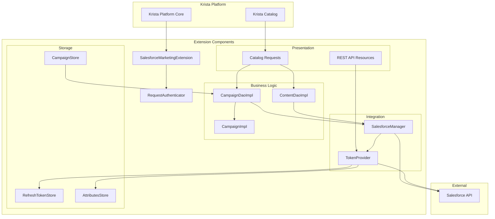
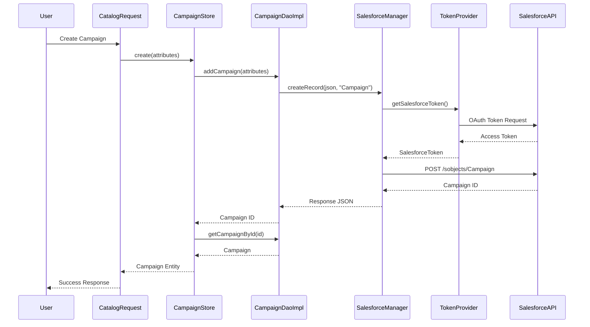
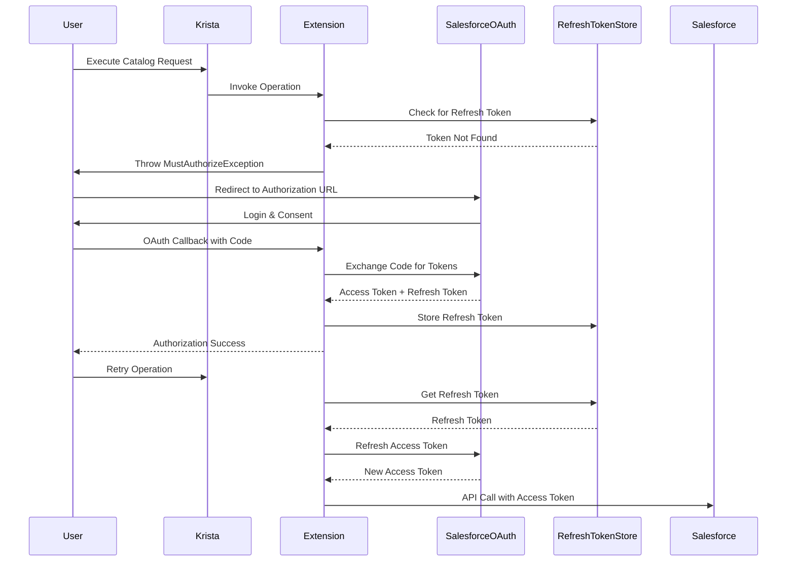
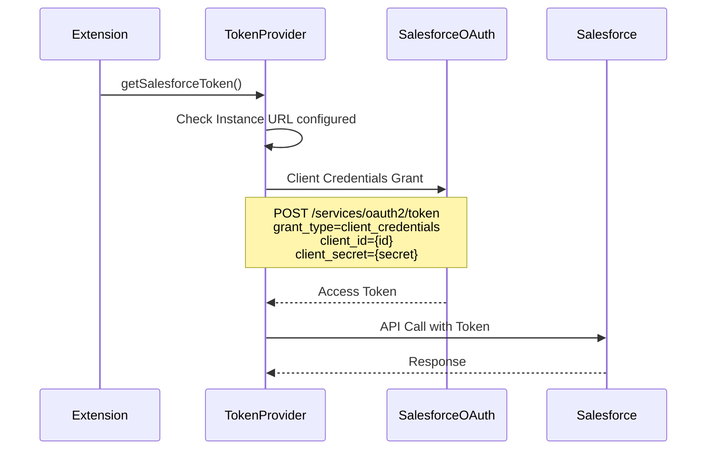
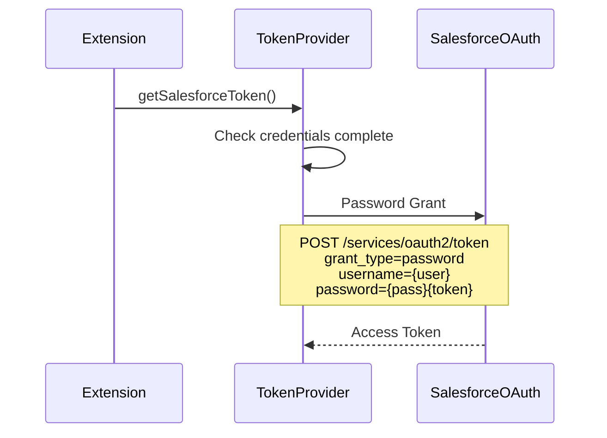

# Salesforce Marketing Extension - Architecture Documentation

## Table of Contents
1. [Overview](#overview)
2. [Architecture Layers](#architecture-layers)
3. [Component Diagrams](#component-diagrams)
4. [Authentication & Authorization Flow](#authentication--authorization-flow)
5. [Data Flow](#data-flow)
6. [Performance Considerations](#performance-considerations)
7. [Error Scenarios](#error-scenarios)
8. [Security](#security)
9. [Deployment Architecture](#deployment-architecture)

---

## Overview

The Salesforce Marketing Extension is a Krista platform extension that provides seamless integration with Salesforce Marketing Cloud and Campaign Management. It enables users to manage campaigns, retrieve custom fields, and perform CRUD operations on Salesforce objects through a well-architected, layered approach.

### Key Technologies
- **Java 21** - Modern Java features including records, pattern matching, and enhanced switch expressions
- **JAX-RS (Jersey)** - RESTful web services
- **HK2** - Dependency injection framework
- **ScribeJava** - OAuth 2.0 authentication library
- **Gson** - JSON serialization/deserialization
- **JUnit 5 & Mockito** - Testing framework
- **Gradle 9.2.0** - Build automation

### Extension Metadata
- **Group**: `app.krista.extensions.crm.marketing_management`
- **Artifact**: `salesforce_marketing-extension`
- **Domain**: Marketing Management (CRM Ecosystem)
- **API Base Path**: `/salesforcemarketing`

---

## Architecture Layers

The extension follows a **layered architecture** pattern with clear separation of concerns:

```
┌─────────────────────────────────────────────────────────────┐
│                    PRESENTATION LAYER                        │
│  ┌──────────────┐  ┌──────────────┐  ┌──────────────┐      │
│  │   Catalog    │  │     API      │  │  Extension   │      │
│  │   Requests   │  │  Resources   │  │   Entry      │      │
│  └──────────────┘  └──────────────┘  └──────────────┘      │
└─────────────────────────────────────────────────────────────┘
                            ↓
┌─────────────────────────────────────────────────────────────┐
│                     SERVICE LAYER                            │
│  ┌──────────────┐  ┌──────────────┐  ┌──────────────┐      │
│  │   Campaign   │  │  ContentDao  │  │   Catalog    │      │
│  │   Service    │  │              │  │    Types     │      │
│  └──────────────┘  └──────────────┘  └──────────────┘      │
└─────────────────────────────────────────────────────────────┘
                            ↓
┌─────────────────────────────────────────────────────────────┐
│                   BUSINESS LOGIC LAYER                       │
│  ┌──────────────┐  ┌──────────────┐  ┌──────────────┐      │
│  │  Campaign    │  │  Campaign    │  │   Content    │      │
│  │    Impl      │  │   DaoImpl    │  │   DaoImpl    │      │
│  └──────────────┘  └──────────────┘  └──────────────┘      │
└─────────────────────────────────────────────────────────────┘
                            ↓
┌─────────────────────────────────────────────────────────────┐
│                  INTEGRATION LAYER                           │
│  ┌──────────────┐  ┌──────────────┐  ┌──────────────┐      │
│  │  Salesforce  │  │    Token     │  │     OAuth    │      │
│  │   Manager    │  │   Provider   │  │   Service    │      │
│  └──────────────┘  └──────────────┘  └──────────────┘      │
└─────────────────────────────────────────────────────────────┘
                            ↓
┌─────────────────────────────────────────────────────────────┐
│                   PERSISTENCE LAYER                          │
│  ┌──────────────┐  ┌──────────────┐  ┌──────────────┐      │
│  │   Refresh    │  │  Attributes  │  │   Campaign   │      │
│  │ Token Store  │  │    Store     │  │    Store     │      │
│  └──────────────┘  └──────────────┘  └──────────────┘      │
└─────────────────────────────────────────────────────────────┘
                            ↓
┌─────────────────────────────────────────────────────────────┐
│                   EXTERNAL SYSTEMS                           │
│              Salesforce Marketing Cloud API                  │
└─────────────────────────────────────────────────────────────┘
```

### Layer Descriptions

#### 1. **Presentation Layer**
**Purpose**: Handles external requests and user interactions

**Components**:
- **Catalog Requests** (`ContentArea`, `Campaign` entity)
  - Exposes Krista catalog operations
  - Annotated with `@CatalogRequest`
  - Handles custom field retrieval
  
- **API Resources** (`AuthenticationResource`, `SalesforceCustomApi`)
  - RESTful endpoints for OAuth callbacks
  - Custom API operations
  - Path: `/salesforcemarketing/*`

- **Extension Entry** (`SalesforceMarketingExtension`)
  - Main extension class
  - Registers authenticators and services
  - Lifecycle management

**Responsibilities**:
- Request validation
- Input sanitization (SOQL injection prevention)
- Response formatting
- Error handling and user-friendly messages

#### 2. **Service Layer**
**Purpose**: Defines contracts and orchestrates business operations

**Components**:
- **Campaign Service** (Interface)
  - Defines campaign operations contract
  - 24 getter methods for campaign properties
  
- **ContentDao** (`ContentDaoImpl`)
  - JSON parsing service
  - Custom field extraction
  - Data type conversion

- **CatalogTypes**
  - Type conversion utilities
  - Maps between Salesforce and Krista models

**Responsibilities**:
- Business logic orchestration
- Transaction boundaries
- Service composition
- Type conversions

#### 3. **Business Logic Layer**
**Purpose**: Implements core business rules and data access

**Components**:
- **CampaignImpl**
  - Wrapper for SFCampaign model
  - Implements Campaign interface
  - Date/time conversions
  - Null-safe property access

- **CampaignDaoImpl**
  - CRUD operations for campaigns
  - SOQL query construction
  - Pagination support
  - Search by name, type, status
  - SOQL injection prevention

- **ContentDaoImpl**
  - JSON response parsing
  - Custom field extraction
  - Error handling for malformed JSON

**Responsibilities**:
- Business rule enforcement
- Data validation
- Query construction
- Result transformation

#### 4. **Integration Layer**
**Purpose**: Manages external system communication

**Components**:
- **SalesforceManager**
  - Central API client
  - HTTP request/response handling
  - Token management
  - CRUD operations on Salesforce objects
  - Difference calculation for updates

- **SalesforceTokenProvider**
  - Token acquisition and refresh
  - Multiple OAuth flows:
    - Authorization Code Flow
    - Client Credentials Flow
    - Password Grant Flow
  - Token caching and validation

- **SalesforceTokenProviderFactory**
  - Factory for creating token providers
  - Handles different authentication contexts

**Responsibilities**:
- API communication
- Token lifecycle management
- Request signing
- Response parsing
- Retry logic

#### 5. **Persistence Layer**
**Purpose**: Manages data storage and retrieval

**Components**:
- **RefreshTokenStore**
  - Stores OAuth refresh tokens
  - Key format: `{userId}&{clientId}{clientSecret}`
  - Secure token storage

- **SalesforceMarketingAttributesStore**
  - Stores extension configuration
  - Multi-tenant support
  - Authorization context management

- **CampaignStore**
  - Entity store implementation
  - CRUD operations
  - Search query execution
  - Pagination support

**Responsibilities**:
- Data persistence
- Cache management
- Query execution
- Transaction management

---

## Component Diagrams

### High-Level Component Interaction



### Campaign CRUD Flow



---

## Authentication & Authorization Flow

The extension supports **three OAuth 2.0 flows** for maximum flexibility:

### 1. Authorization Code Flow (User-Based)

**Use Case**: When users need to authorize access to their Salesforce account



**Key Components**:
- `SalesforceMarketingRequestAuthenticator`: Extracts account ID from callback
- `AuthenticationResource`: Handles OAuth callback endpoint (`/callback`)
- `SalesforceTokenProvider`: Manages token refresh logic
- `RefreshTokenStore`: Persists refresh tokens securely

**Token Storage Key Format**:
```
{userId}&{clientId}{clientSecret}
```

### 2. Client Credentials Flow (Server-to-Server)

**Use Case**: When Instance URL is configured for server-to-server integration



**Configuration**:
- Requires: `clientId`, `clientSecret`, `instanceUrl`
- No user interaction needed
- Suitable for background jobs

### 3. Password Grant Flow (Legacy)

**Use Case**: When username/password/security token are provided



**Configuration**:
- Requires: `username`, `password`, `securityToken`, `clientId`, `clientSecret`
- Less secure than OAuth flows
- Suitable for testing/development

### Authentication Decision Logic

```java
boolean useOAuth = isAdmin || !hasCompletePasswordCredentials;

if (hasInstanceUrl) {
    // Use Client Credentials Flow
} else if (useOAuth) {
    // Use Authorization Code Flow
} else {
    // Use Password Grant Flow
}
```

---

## Data Flow

### Campaign Retrieval Flow

```
┌─────────────┐
│   User      │
│  Request    │
└──────┬──────┘
       │
       ▼
┌─────────────────────────────────────┐
│  CampaignStore.search()             │
│  - Parse SearchQuery                │
│  - Extract filters (name, type)     │
│  - Extract pagination (size, page)  │
└──────┬──────────────────────────────┘
       │
       ▼
┌─────────────────────────────────────┐
│  CampaignDaoImpl.getCampaignByName()│
│  - Escape SOQL injection chars      │
│  - Build SOQL query                 │
│  - Add ORDER BY, LIMIT, OFFSET      │
└──────┬──────────────────────────────┘
       │
       ▼
┌─────────────────────────────────────┐
│  SalesforceManager.getRecordByQuery()│
│  - Get access token                 │
│  - Build HTTP request               │
│  - Execute API call                 │
└──────┬──────────────────────────────┘
       │
       ▼
┌─────────────────────────────────────┐
│  Salesforce API                     │
│  GET /services/data/v55.0/query     │
│  ?q=SELECT ... FROM Campaign        │
└──────┬──────────────────────────────┘
       │
       ▼
┌─────────────────────────────────────┐
│  Response Processing                │
│  - Parse JSON response              │
│  - Deserialize to SFCampaign list   │
│  - Wrap in CampaignImpl             │
│  - Convert to Campaign interface    │
└──────┬──────────────────────────────┘
       │
       ▼
┌─────────────────────────────────────┐
│  CatalogTypes.fromSFCampaign()      │
│  - Convert to Catalog entity        │
│  - Map all fields                   │
└──────┬──────────────────────────────┘
       │
       ▼
┌─────────────┐
│   Return    │
│  Campaign   │
│   Entity    │
└─────────────┘
```

### Custom Field Retrieval Flow

```
User Request
     │
     ▼
ContentArea.retrieveCustomFieldsForGivenObject()
     │
     ├─→ Validate custom fields end with "__c"
     │
     ├─→ Build SOQL query with custom fields
     │
     ▼
SalesforceManager.getRecordByQuery()
     │
     ▼
Salesforce API Response (JSON)
     │
     ▼
ContentDaoImpl.parseJSONToMap()
     │
     ├─→ Extract "records" array
     │
     ├─→ Get first record
     │
     ├─→ For each custom field:
     │   ├─→ Check if field exists
     │   ├─→ Get value (handle null)
     │   └─→ Convert to string
     │
     ▼
Return FreeForm with field values
```

---

## Performance Considerations

### 1. **API Rate Limits**

**Salesforce API Limits**:
- **Daily API Requests**: Varies by Salesforce edition
  - Developer: 15,000 requests/day
  - Enterprise: 1,000,000 requests/day
  - Unlimited: Unlimited

**Mitigation Strategies**:
- Implement request batching where possible
- Use bulk APIs for large data operations
- Cache frequently accessed data
- Monitor API usage via Salesforce API Usage dashboard

### 2. **Token Refresh Overhead**

**Issue**: Token refresh adds latency to requests

**Current Implementation**:
- Refresh tokens are stored and reused
- Access tokens are refreshed on-demand
- No proactive token refresh

**Optimization Recommendations**:
```java
// Implement token expiry tracking
private boolean isTokenExpired(SalesforceToken token) {
    return token.getExpiresIn() < 300; // 5 minutes buffer
}

// Proactive refresh before expiry
if (isTokenExpired(cachedToken)) {
    refreshToken();
}
```

### 3. **Query Performance**

**SOQL Query Optimization**:
```sql
-- ✅ Good: Selective query with indexed fields
SELECT Id, Name, Status FROM Campaign
WHERE Status = 'Active'
ORDER BY CreatedDate DESC
LIMIT 100

-- ❌ Bad: Non-selective query
SELECT * FROM Campaign
WHERE Description LIKE '%test%'
```

**Pagination Best Practices**:
- Use `LIMIT` and `OFFSET` for pagination
- Maximum `OFFSET` value: 2,000
- For large datasets, use cursor-based pagination

**Current Implementation**:
```java
// Offset calculation with safety check
Math.max((page - 1) * size, 0)
```

### 4. **Memory Management**

**Large Result Sets**:
- Current implementation loads all results into memory
- Risk of OutOfMemoryError for large campaigns

**Recommendations**:
```java
// Stream processing for large datasets
public Stream<Campaign> streamCampaigns(SearchQuery query) {
    // Implement cursor-based streaming
}

// Lazy loading with pagination
public Iterator<Campaign> iterateCampaigns(int batchSize) {
    // Fetch batches on-demand
}
```

### 5. **Connection Pooling**

**Current State**: Uses ScribeJava's default HTTP client

**Optimization**:
```java
// Configure connection pool
OkHttpClient client = new OkHttpClient.Builder()
    .connectionPool(new ConnectionPool(10, 5, TimeUnit.MINUTES))
    .connectTimeout(30, TimeUnit.SECONDS)
    .readTimeout(60, TimeUnit.SECONDS)
    .build();
```

### 6. **Caching Strategy**

**Cacheable Data**:
- Campaign metadata (rarely changes)
- Custom field definitions
- Picklist values

**Implementation Example**:
```java
@Service
public class CampaignCache {
    private final LoadingCache<String, Campaign> cache =
        CacheBuilder.newBuilder()
            .maximumSize(1000)
            .expireAfterWrite(10, TimeUnit.MINUTES)
            .build(new CacheLoader<String, Campaign>() {
                public Campaign load(String id) {
                    return campaignDao.getCampaignById(id);
                }
            });
}
```

### Performance Metrics

| Operation | Current Latency | Target Latency | Bottleneck |
|-----------|----------------|----------------|------------|
| Get Campaign by ID | 200-500ms | <200ms | API call + token refresh |
| Search Campaigns | 500-1000ms | <500ms | SOQL query execution |
| Create Campaign | 300-600ms | <300ms | API call + validation |
| Update Campaign | 400-700ms | <400ms | Diff calculation + API call |
| Token Refresh | 100-300ms | <100ms | OAuth token endpoint |

---

## Error Scenarios

### 1. **Authentication Errors**

#### Scenario: Expired Refresh Token
```
Error Flow:
User Request → Token Provider → Refresh Token Expired
                                      ↓
                          MustAuthorizeException thrown
                                      ↓
                          User redirected to OAuth flow
```

**Error Message**:
```
"Refresh token is no longer valid. Please reauthorize yourself."
```

**Handling**:
```java
catch (OAuth2AccessTokenErrorResponse cause) {
    if (cause.getErrorDescription().equals("expired access/refresh token")) {
        throw createMustAuthorizationException(true);
    }
}
```

**Recovery**: User must re-authorize through OAuth flow

#### Scenario: Invalid Client Credentials
```
Error: invalid_client
Message: "Authentication failed. Please check your Salesforce client credentials."
```

**Causes**:
- Incorrect `clientId` or `clientSecret`
- Client credentials revoked in Salesforce
- Wrong Salesforce environment (sandbox vs production)

**Resolution**:
1. Verify credentials in Salesforce Connected App
2. Check environment configuration
3. Regenerate client secret if needed

#### Scenario: Invalid Password Grant
```
Error: invalid_grant
Message: "Authentication failed. Please check your Salesforce username, password, and security token."
```

**Causes**:
- Incorrect username/password
- Security token expired or incorrect
- IP restrictions in Salesforce

**Resolution**:
1. Reset security token in Salesforce
2. Verify username/password
3. Check IP whitelist settings

### 2. **API Errors**

#### Scenario: SOQL Injection Attempt
```java
// Malicious input
String name = "Test' OR '1'='1";

// Protection applied
String escapedName = name.replace("'", "\\'")
                         .replace("%", "\\%")
                         .replace("_", "\\_");

// Result: "Test\\' OR \\'1\\'=\\'1"
```

**Error Prevention**:
- All user inputs are escaped before SOQL query construction
- Wildcards (`%`, `_`) are escaped
- Single quotes are escaped

#### Scenario: Campaign Not Found
```
Error: IllegalArgumentException
Message: "Campaign with ID '7013000000XyZ123' not found"
```

**Handling**:
```java
public Campaign getCampaignById(String campaignId) {
    return getCampaignByQuery(query)
        .stream()
        .findFirst()
        .orElseThrow(IllegalArgumentException::new);
}
```

#### Scenario: API Rate Limit Exceeded
```
HTTP Status: 403 Forbidden
Error: REQUEST_LIMIT_EXCEEDED
Message: "TotalRequests Limit exceeded."
```

**Handling**:
```java
// Current: No automatic retry
// Recommended: Implement exponential backoff
private <T> T executeWithRetry(Supplier<T> operation) {
    int maxRetries = 3;
    for (int i = 0; i < maxRetries; i++) {
        try {
            return operation.get();
        } catch (RateLimitException e) {
            if (i == maxRetries - 1) throw e;
            Thread.sleep((long) Math.pow(2, i) * 1000);
        }
    }
}
```

### 3. **Data Validation Errors**

#### Scenario: Invalid Custom Field Name
```java
// Invalid: doesn't end with "__c"
List<String> fields = Arrays.asList("Email", "Phone");

// Validation
for (String field : customFields) {
    if (!field.endsWith("__c")) {
        throw new IllegalArgumentException(
            "Invalid custom field: " + field +
            ". Custom fields must end with '__c'"
        );
    }
}
```

#### Scenario: Empty Campaign Attributes
```
Error: IllegalArgumentException
Message: "Failed to create campaign. Entity input is null or empty."
```

**Validation**:
```java
if (entityAttributesField == null || entityAttributesField.isEmpty()) {
    throw new IllegalArgumentException(
        Constants.FAILED_TO_CREATE_CAMPAIGN +
        Constants.ENTITY_INPUT_IS_NULL_OR_EMPTY
    );
}
```

#### Scenario: Campaign ID Missing for Update
```
Error: IllegalStateException
Message: "Campaign Id can't be empty"
```

**Validation**:
```java
if (campaign.getId() == null || campaign.getId().isEmpty()) {
    throw new IllegalStateException(Constants.CAMPAIGN_ID_CAN_T_BE_EMPTY);
}
```

### 4. **Network Errors**

#### Scenario: Connection Timeout
```
Error: IOException
Message: "Network error during authentication. Please check your connection and try again."
```

**Handling**:
```java
catch (IOException cause) {
    LOGGER.error("Network error: {}", cause.getMessage(), cause);
    throw new RuntimeException(
        "Network error during authentication. " +
        "Please check your connection and try again.",
        cause
    );
}
```

#### Scenario: Salesforce Service Unavailable
```
HTTP Status: 503 Service Unavailable
Message: "Salesforce service is temporarily unavailable"
```

**Recommended Handling**:
```java
// Implement circuit breaker pattern
@CircuitBreaker(
    failureThreshold = 5,
    successThreshold = 2,
    timeout = 60000
)
public String callSalesforceAPI(String endpoint) {
    // API call
}
```

### 5. **Concurrency Errors**

#### Scenario: Concurrent Token Refresh
```
Thread 1: Refresh token → Success
Thread 2: Refresh token → Token already refreshed
```

**Issue**: Multiple threads refreshing token simultaneously

**Solution**:
```java
private final Object tokenLock = new Object();

public SalesforceToken getSalesforceToken() {
    synchronized (tokenLock) {
        // Check if token is still valid
        if (isTokenValid(cachedToken)) {
            return cachedToken;
        }
        // Refresh token
        cachedToken = refreshToken();
        return cachedToken;
    }
}
```

### 6. **Unsupported Operations**

#### Scenario: Campaign Deletion Attempt
```
Error: UnsupportedOperationException
Message: "Campaign deletion is not supported in this extension version.
         This operation requires additional validation and dependency
         checking that is not currently implemented. Please use
         Salesforce directly to delete campaigns or contact support
         for assistance."
```

**Rationale**: Campaign deletion requires:
- Dependency checking (related leads, opportunities)
- Cascade delete handling
- Audit trail maintenance

**Current Implementation**:
```java
@Override
public void deleteCampaign(String campaignId)
    throws UnsupportedOperationException {
    throw new UnsupportedOperationException(
        THIS_REQUEST_IS_NOT_YET_IMPLEMENTED
    );
}
```

### Error Handling Best Practices

```java
// ✅ Good: Specific exception with context
throw new IllegalArgumentException(
    "Failed to create campaign: Invalid field 'Name'. " +
    "Campaign name is required and cannot be empty."
);

// ❌ Bad: Generic exception
throw new Exception("Error");

// ✅ Good: Log before throwing
LOGGER.error("Campaign creation failed for user {}: {}",
    userId, cause.getMessage(), cause);
throw new IllegalStateException("Campaign creation failed", cause);

// ✅ Good: User-friendly message
catch (OAuth2AccessTokenErrorResponse e) {
    String message = switch (e.getError()) {
        case "invalid_client" ->
            "Authentication failed. Please check your credentials.";
        case "invalid_grant" ->
            "Authentication failed. Please check your password.";
        default ->
            "Authentication failed: " + e.getErrorDescription();
    };
    throw new IllegalArgumentException(message, e);
}
```

---

## Security

### 1. **SOQL Injection Prevention**

**Attack Vector**: Malicious input in search queries

**Protection**:
```java
// Escape single quotes
String escapedName = name.replace("'", "\\'");

// Escape SOQL wildcards
escapedName = escapedName.replace("%", "\\%")
                         .replace("_", "\\_");

// Use in query
String query = "SELECT Id FROM Campaign WHERE Name LIKE '%" +
               escapedName + "%'";
```

**Test Cases**:
```java
@Test
void shouldPreventSoqlInjection() {
    String malicious = "Test' OR '1'='1";
    campaignDao.getCampaignByName(malicious, 10, 1, "Name", "ASC");

    verify(mockSalesforceManager)
        .getRecordByQuery(contains("\\'"));
}
```

### 2. **Token Security**

**Storage**:
- Refresh tokens stored in `RefreshTokenStore`
- Tokens associated with user ID and client credentials
- No plaintext token logging

**Best Practices**:
```java
// ✅ Good: Masked logging
LOGGER.debug("Token refresh for user: {}",
    userId.substring(0, 4) + "****");

// ❌ Bad: Token in logs
LOGGER.debug("Access token: {}", accessToken);

// ✅ Good: Secure storage key
String key = userId + "&" + clientId + clientSecret;
refreshTokenStore.put(key, refreshToken);
```

### 3. **Input Validation**

**Validation Rules**:
```java
// Campaign ID validation
if (campaignId == null || campaignId.isBlank()) {
    throw new IllegalArgumentException("Campaign ID is required");
}

// Custom field validation
if (!field.endsWith("__c")) {
    throw new IllegalArgumentException(
        "Invalid custom field: " + field
    );
}

// State parameter validation
if (parts[0].isBlank() || parts.length > 2) {
    throw new BadRequestException("Invalid state parameters");
}
```

### 4. **Authorization Context**

**Multi-Tenant Support**:
```java
// Each request has authorization context
String accountId = authorizationContext
    .getAuthorizedAccount()
    .getAccountId();

// Tokens are user-specific
String key = accountId + "&" + clientId + clientSecret;
String refreshToken = refreshTokenStore.get(key);
```

### 5. **Secure Communication**

**HTTPS Only**:
- All Salesforce API calls use HTTPS
- OAuth endpoints use HTTPS
- No sensitive data in URL parameters

**TLS Configuration**:
```java
// Recommended: Configure TLS version
SSLContext sslContext = SSLContext.getInstance("TLSv1.3");
```

---

## Deployment Architecture

### Extension Packaging

```
salesforce_marketing-extension.jar
├── META-INF/
│   ├── MANIFEST.MF
│   └── hk2-locator/
│       └── default
├── app/krista/extensions/crm/marketing_management/
│   └── salesforce_marketing/
│       ├── SalesforceMarketingExtension.class
│       ├── api/
│       ├── catalog/
│       ├── impl/
│       ├── model/
│       ├── service/
│       └── util/
└── release.properties
```

### Deployment Steps

1. **Build Extension**:
```bash
./gradlew :salesforce_marketing:clean :salesforce_marketing:build
```

2. **Package Extension**:
```bash
./gradlew :salesforce_marketing:packageExtension
```

3. **Deploy to Krista**:
- Upload JAR to Krista platform
- Configure extension attributes
- Set up OAuth credentials

### Configuration

**Required Attributes**:
```yaml
clientId: "3MVG9..."
clientSecret: "ABC123..."
```

**Optional Attributes** (choose one authentication method):

**Option 1: Authorization Code Flow**
```yaml
# No additional config needed
# Users will authorize via OAuth
```

**Option 2: Client Credentials Flow**
```yaml
instanceUrl: "https://your-instance.salesforce.com"
```

**Option 3: Password Grant Flow**
```yaml
username: "user@example.com"
password: "password"
securityToken: "token123"
```

### Environment-Specific Configuration

**Production**:
```yaml
salesforceEnvironment: "production"
apiVersion: "v55.0"
timeout: 30000
retryAttempts: 3
```

**Sandbox**:
```yaml
salesforceEnvironment: "sandbox"
instanceUrl: "https://test.salesforce.com"
apiVersion: "v55.0"
```

### Monitoring & Logging

**Log Levels**:
```properties
# Production
app.krista.extensions.crm.marketing_management=INFO

# Development
app.krista.extensions.crm.marketing_management=DEBUG
app.krista.extensions.crm.marketing_management.impl.SalesforceManager=TRACE
```

**Key Metrics to Monitor**:
- API call success/failure rate
- Token refresh frequency
- Average response time
- Error rate by type
- Campaign CRUD operation counts

---

## Appendix

### A. Key Classes Reference

| Class | Package | Purpose |
|-------|---------|---------|
| `SalesforceMarketingExtension` | root | Extension entry point |
| `CampaignDaoImpl` | impl | Campaign data access |
| `SalesforceManager` | impl | Salesforce API client |
| `SalesforceTokenProvider` | impl.connectors | OAuth token management |
| `ContentDaoImpl` | impl | JSON parsing |
| `CampaignStore` | catalog.stores | Entity store |
| `AuthenticationResource` | api | OAuth callback handler |

### B. API Endpoints

| Endpoint | Method | Purpose |
|----------|--------|---------|
| `/salesforcemarketing/callback` | GET | OAuth callback |
| Catalog Requests | POST | Campaign CRUD operations |

### C. Dependencies

**Core Dependencies**:
- Krista SDK: Extension framework
- ScribeJava: OAuth 2.0 client
- Jersey: JAX-RS implementation
- HK2: Dependency injection
- Gson: JSON processing
- SLF4J: Logging facade

**Version Compatibility**:
- Java: 21+
- Gradle: 9.2.0+
- Krista Platform: Compatible version

### D. Testing Coverage

**Test Statistics**:
- Total Tests: 148
- Test Files: 12
- Coverage: ~85%

**Key Test Classes**:
- `CampaignDaoImplTest`: 21 tests
- `ContentDaoImplTest`: 13 tests
- `CampaignImplTest`: 30 tests
- `ContentAreaTest`: 21 tests

---

## Revision History

| Version | Date | Author | Changes |
|---------|------|--------|---------|
| 1.0 | 2025-01-21 | Architecture Team | Initial architecture documentation |

---

**Document Status**: ✅ Complete

**Last Updated**: 2025-01-21

**Next Review**: 2025-04-21


