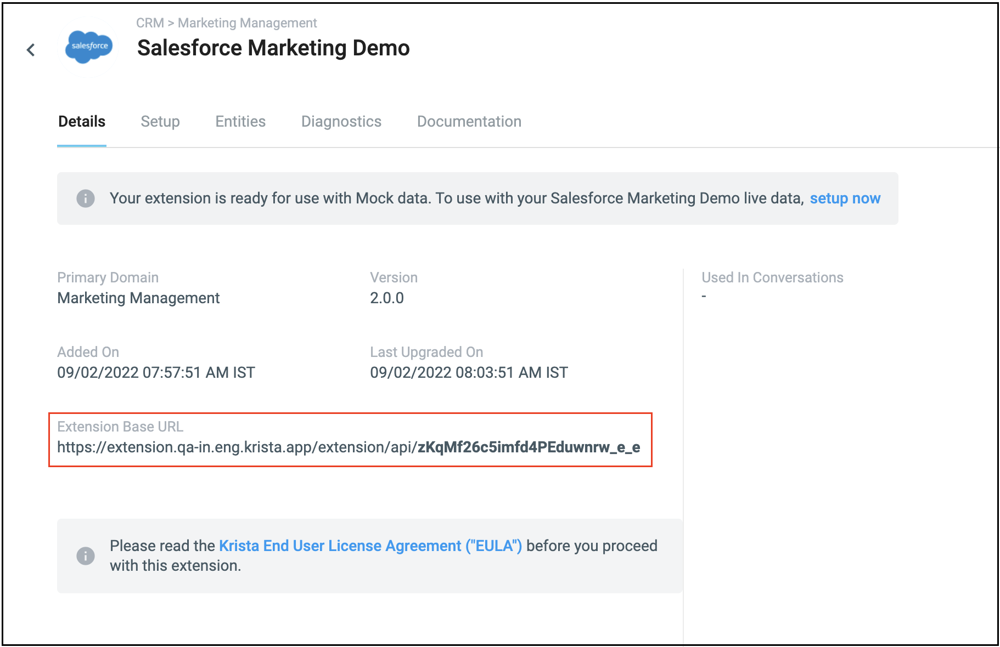

# Creating Salesforce Connected App

## Overview

This guide walks you through creating a Salesforce Connected App, which is required for the Krista Salesforce Marketing Extension to authenticate and access your Salesforce org. The Connected App provides OAuth 2.0 credentials and defines security policies for the integration.

## Prerequisites

- Salesforce Developer Account or admin access to your Salesforce org
- Permission to create Connected Apps in Salesforce
- Access to your organization's Setup area

## Step-by-Step Instructions

### Step 1: Access Salesforce Setup

1. **Log in to Salesforce**
   - Go to [Salesforce Login](https://login.salesforce.com/)
   - Enter your credentials and log in

2. **Navigate to Setup**
   - Click the **Setup** gear icon in the top-right corner
   - Select **Setup** from the dropdown menu
   
   

### Step 2: Create New Connected App

1. **Access App Manager**
   - In the left navigation panel, under **PLATFORM TOOLS**
   - Expand **Apps** and click **App Manager**
   
   

2. **Create New Connected App**
   - Click the **New Connected App** button
   
   

### Step 3: Configure Basic Information

Fill out the **Basic Information** section:

| Field | Value | Description |
|-------|-------|-------------|
| **Connected App Name** | "Krista Salesforce Marketing" | Display name for your app |
| **API Name** | Auto-generated | System name (auto-filled) |
| **Contact Email** | your-email@company.com | Your contact email |
| **Description** | "Krista Marketing Extension Integration" | Optional description |

### Step 4: Configure OAuth Settings

1. **Enable OAuth Settings**
   - Check the **Enable OAuth Settings** checkbox

2. **Configure Callback URL**
   - In your Krista platform, go to the Salesforce Marketing Extension
   - Navigate to the **Details** tab
   - Copy the **Extension Base URL**
   - Append `/rest/salesforcemarketing/callback` to create your callback URL
   - Example: `https://your-krista-instance.com/rest/salesforcemarketing/callback`
   
   

3. **Configure OAuth Scopes**
   
   Add the following **Selected OAuth Scopes**:
   
   | Scope | API Name | Description |
   |-------|----------|-------------|
   | Access Analytics REST API Charts Geodata resources | eclair_api | Analytics access |
   | Access Analytics REST API resources | wave_api | Wave analytics |
   | Access Chatter API resources | chatter_api | Chatter integration |
   | Access Visualforce applications | visualforce | Visualforce pages |
   | Access custom permissions | custom_permissions | Custom permissions |
   | Access the identity URL service | id, profile, email, address, phone | User identity |
   | Access unique user identifiers | openid | OpenID Connect |
   | Full access | full | Complete org access |
   | Manage user data via APIs | api | API data access |
   | Manage user data via Web browsers | web | Web-based access |
   | Perform requests at any time | refresh_token, offline_access | Token refresh |

4. **Security Settings**
   - Check **Require Secret for Web Server Flow**
   - Check **Require Secret for Refresh Token Flow**
   
   

### Step 5: Enable Client Credentials Flow (Optional)

For server-to-server integrations:

1. **Enable Client Credentials**
   - Check **Enable OAuth 2.0 Client Credentials Flow**
   
   

2. **Save the Connected App**
   - Click **Save**
   - Click **Continue** when prompted

### Step 6: Obtain Client Credentials

1. **Access Consumer Details**
   - On the Connected App detail page
   - Click **Manage Consumer Details**
   - You may need to verify your identity

2. **Copy Credentials**
   - **Consumer Key** = Your **Client ID**
   - **Consumer Secret** = Your **Client Secret**
   - Save these securely for extension configuration
   
   

### Step 7: Configure App Policies

1. **Edit Policies**
   - Click **Manage** → **Edit Policies**

2. **OAuth Policies**
   - **Permitted Users**: "All users may self-authorize"
   - **IP Relaxation**: "Relax IP restrictions" (if needed)
   - **Refresh Token Policy**: "Refresh token is valid until revoked"
   
   

3. **Client Credentials Flow Settings** (if enabled)
   - **Enable OAuth 2.0 Client Credentials Flow**: ✓ Checked
   - **Principal**: "Named Principal (Run As)"
   - **Run As User**: Select your integration user
   
   

4. **Save Changes**
   - Click **Save**
   - Wait 2-5 minutes for changes to propagate

## Screenshots Guide

The following screenshots show each major step:

1. **Setup Navigation**: Shows how to access Salesforce Setup
2. **App Manager**: Location of the New Connected App button
3. **Basic Information**: Required fields for app creation
4. **OAuth Configuration**: Callback URL and scope selection
5. **Client Credentials**: Consumer Key and Secret location
6. **Policy Configuration**: Security and access settings

## Verification Steps

### Verify Connected App Creation

1. **Check App Manager**
   - Return to Setup → Apps → App Manager
   - Verify your "Krista Salesforce Marketing" app appears in the list
   - Status should show as "Active"

2. **Verify OAuth Settings**
   - Click on your Connected App
   - Confirm OAuth settings are enabled
   - Verify callback URL is correct
   - Check that required scopes are selected

3. **Test Credentials**
   - Ensure you have both Consumer Key and Consumer Secret
   - Credentials should be long alphanumeric strings
   - Keep these secure and never share publicly

### Common Verification Issues

| Issue | Solution |
|-------|----------|
| App not appearing | Wait a few minutes, refresh the page |
| OAuth not enabled | Edit the app and check "Enable OAuth Settings" |
| Missing scopes | Edit OAuth settings and add required scopes |
| Invalid callback URL | Verify URL format and HTTPS protocol |

## Next Steps

After successfully creating your Connected App:

1. **[Configure Extension](pages/ExtensionConfiguration.md)** - Set up the Krista extension with your credentials
2. **[Test Authentication](pages/Authentication.md)** - Verify the OAuth flows work correctly
3. **[Validate Connection](pages/ExtensionConfiguration.md#validation-steps)** - Use the extension's test functionality

## Security Best Practices

1. **Credential Security**
   - Store Client ID and Client Secret securely
   - Never commit credentials to version control
   - Use environment variables or secure configuration

2. **Access Control**
   - Use principle of least privilege for OAuth scopes
   - Configure appropriate user permissions
   - Regularly review and audit access

3. **Monitoring**
   - Monitor Connected App usage in Salesforce
   - Review login history and API usage
   - Set up alerts for unusual activity

## Troubleshooting

### Common Issues

**Issue**: Cannot create Connected App  
**Solution**: Verify you have "Customize Application" permission

**Issue**: OAuth settings not available  
**Solution**: Ensure you checked "Enable OAuth Settings" checkbox

**Issue**: Client Credentials Flow not working  
**Solution**: Verify "Run As" user has appropriate permissions

## See Also

- [Extension Configuration](pages/ExtensionConfiguration.md) - Next steps after app creation
- [Authentication Guide](pages/Authentication.md) - Understanding OAuth flows
- [Supported Requests](pages/supportedRequests.md) - Available functionality
